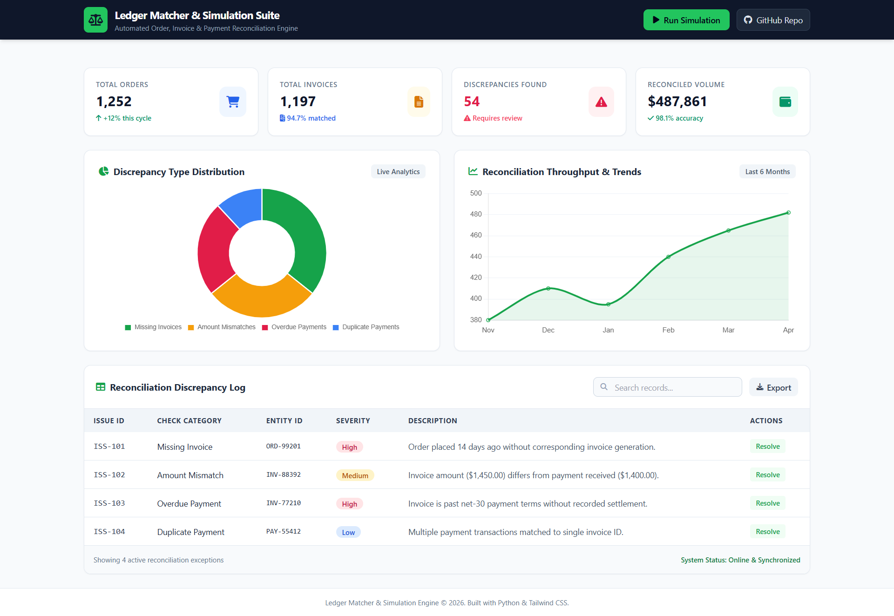

# Ledger Matcher & Simulation Suite

**Automated Order, Invoice & Payment Reconciliation Engine**

## Overview

Ledger Matcher is a Python-based financial reconciliation application designed to automate the matching and validation of orders, invoices, and payment records.

The application identifies financial discrepancies, generates Excel reports, and provides an interactive web dashboard for monitoring reconciliation results.

## Project Demo

🎬 Watch the Ledger Matcher demonstration:
https://github.com/user-attachments/assets/2624005f-3fc7-4cb4-9cd1-4ed2cb44f1e6

## Dashboard Preview



## Key Features

- **Automated Reconciliation:** Matches orders, invoices, and payment records.
- **Discrepancy Detection:** Identifies overdue invoices, unbilled orders, duplicate invoices, invoice mismatches, short payments, and overpayments.
- **Excel Reporting:** Generates structured reconciliation reports.
- **Data Simulation:** Generates sample financial transaction data for testing.
- **Interactive Dashboard:** Displays reconciliation metrics, charts, and discrepancy records.
- **Web Interface:** Flask-powered dashboard for running the reconciliation pipeline.

## Technology Stack

| Technology | Purpose |
|---|---|
| Python | Core application |
| Pandas | Data processing and analysis |
| Flask | Web application |
| OpenPyXL | Excel report generation |
| HTML / CSS / JavaScript | Dashboard interface |
| Pytest | Testing |

## Project Architecture

1. Sample transaction data is generated.
2. Orders, invoices, and payments are loaded.
3. Reconciliation checks are performed.
4. Financial discrepancies are identified.
5. Results are exported to Excel.
6. The Flask dashboard presents the results.

## Installation & Setup

Clone the repository:

```bash
git clone https://github.com/mostalx/ledger-matcher-pro.git
cd ledger-matcher-pro
```

Create a virtual environment:

```bash
python -m venv .venv
```

Activate it on Windows:

```powershell
.\.venv\Scripts\Activate.ps1
```

Install dependencies:

```bash
python -m pip install -r requirements.txt
```

## Running the Application

Generate sample data:

```bash
python generate_data.py
```

Run reconciliation:

```bash
python main.py
```

Start the web dashboard:

```bash
python app.py
```

Open your browser:

http://127.0.0.1:5000

## Example Discrepancies

- Overdue invoices
- Unbilled orders
- Duplicate invoices
- Invoices without matching orders
- Payments without invoices
- Short payments
- Invoice amount mismatches
- Overpayments

## Project Purpose

This project demonstrates the application of Python programming, financial data processing, business process automation, and interactive data visualization to a practical accounting and financial operations use case.

## Disclaimer

This project uses simulated/sample transaction data for demonstration and educational purposes. It is not intended to process real financial transactions without further validation and security controls.

## Author

**Moustafa Abdalla**

GitHub: https://github.com/mostalx

---

*Built with Python to explore financial automation, reconciliation, and data analytics.*
